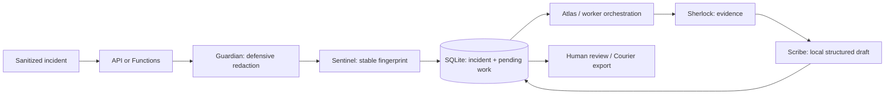

# Architecture

The previous conversation's assistant architecture was unavailable (reference placeholders).
This scaffold follows the paths and requirements in the current request; the role assignments below
are explicit implementation choices.

Atlas coordinates intake. Sentinel hashes service, environment, exception, normalized message and
stack. Fingerprint v2 excludes event time and normalizes durations, UUIDs, explicit request/trace/
correlation IDs and source line numbers. HTTP status codes, error codes, ports, versions and business
values remain significant. Distinct messages and environments
remain separate. This heuristic can still merge failures differing only in normalized values or split textual variants;
review is required. Fingerprint v2 changes keys from the initial broad numeric-normalization scheme.
Old keys/drafts remain readable, but new events do not deduplicate against legacy keys. There is no
automatic migration; use a separate fresh database when comparing versions, and retain old data for review.
SQLite uses unique keys and immediate transactions so simultaneous repeats increment exactly once per request.
Delivery is at least once: there is no producer event ID, so transport retries count as occurrences.
A crash during drafting rolls back and the next poll retries. Handled generation/validation failures
commit a generic error code, attempt count and short exponential backoff. The local worker stops
automatically after three failed attempts and excludes failed work from polling, allowing other
eligible incidents to progress. `devswarm retry FINGERPRINT` explicitly resets pending/failed work;
completed drafts stay intact. Existing databases receive additive retry columns under a transaction. Single-transaction local drafting intentionally
serializes workers; it is suitable for a small offline MVP, not slow remote inference.
Only the first sanitized observation is retained per fingerprint; counts include repeats.
Drafts cite exact message/stack excerpts, label root cause and reproduction unknown, and require human review.

Scribe's DraftProvider protocol supports future Azure-hosted LLM adapters; only deterministic local
inference is implemented. IncidentStore defines the persistence seam. Forge is disabled; Guardian
sanitizes inputs; Courier exports JSON without network access. Two FastMCP servers expose only
read/preview operations. No agent can execute telemetry as code or publish a GitHub issue/PR.

## Azure target and staged implementation

Target: Functions ingestion -> Service Bus -> Container Apps worker/API -> durable database/blob evidence,
with managed identities, Entra ID, Key Vault, Monitor and an optional Azure-hosted model.
Terraform currently supplies only the foundation described in its README. Cloud database, queue and
LLM adapters, hosting resources, permissions and deployment pipeline are intentionally unimplemented.
SQLite must not be shared across independently scaled cloud replicas. Do not deploy this local API publicly.

## Package layout

Installable code lives exclusively under `src/devswarm`, including apps, agents, shared modules
and MCP servers. Root apps retain host wrappers; root agent directories point to their packaged
implementations. Pydantic is the base dependency; API, MCP and Functions are optional extras.
The CLI exports local Functions and Terraform templates without provisioning anything.

## Structured review drafts

Every deterministic draft includes observations with evidence IDs, an explicit unknowns list and
conservative review/reproduction next steps. Evidence includes the sanitized message and stack plus
producer-supplied service, environment, exception type and event time. Producer event time is an
observation, not a verified wall-clock claim. Citation references must exist and evidence IDs must
be unique; persistence rejects evidence that differs from the stored sanitized first observation.
The local provider never claims a verified root cause, severity or exact reproduction.
Legacy drafts missing the additive observation/unknown/next-step fields remain readable.
See `examples/bug-draft.json` for deterministic synthetic output and `examples/http-failures.json`
for two distinct HTTP failures with a duration-only repeat.
